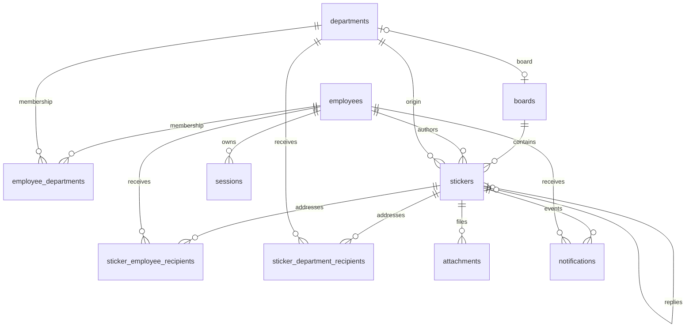

# Схема PostgreSQL — этап 2.2

Это описание исходной модели. В текущей версии дополнительно реализованы вход, закрытое создание сотрудников, управление отделами и профилем; см. [действующие правила и API](accounts.md). Миграция `0001_accounts_access.sql` добавляет `departments.is_active`, `employees.failed_login_count` и `login_blocked_until`; `0002_shared_stickers.sql` добавляет `stickers.revision` для защиты от конфликтов изменений. Миграции `0003` и `0004` расширяют стили бумаги, добавляют независимые крепления и фото профиля; см. [профиль](profile.md). Миграция `0005` добавляет хеш содержимого вложений, а `0006` — подписки [Web Push](push.md). Все миграции проверяются на PGlite; постоянная PostgreSQL отдельно не проверялась.

Источник схемы — `src/db/schema.ts`, связи для relational queries — `src/db/relations.ts`, общий экспорт — `src/db/index.ts`. Плагин передаёт таблицы и связи в Drizzle, поэтому `app.db` типизирован вместе с `db.query`. Если БД отключена, `app.db === null`.

Ниже сохранены детали первоначального проектирования и тогдашние планы сервисного слоя; актуальные поведение доски, доступ и тесты описаны в [shared-board.md](shared-board.md), [accounts.md](accounts.md) и [push.md](push.md). Нынешние интеграционные тесты применяют все миграции на PGlite в памяти, но не заменяют проверку постоянной PostgreSQL.

Основные сущности имеют UUID; ключ push-подписки — URL службы, даты используют `timestamptz`. Модель рассчитана на PostgreSQL 14+ без дополнительных расширений. Первая миграция: `drizzle/0000_initial_schema.sql`; журнал и snapshot находятся в `drizzle/meta/`. Данных и seed-скриптов нет.

## Таблицы и связи

| Таблица | Назначение и связи |
| --- | --- |
| `employees` | Логин, хеш пароля, имя, необязательный аватар, роль `user/admin`, активность, требование смены пароля, предпочтительный стиль, даты. |
| `departments` | Название, уникальный код в нижнем регистре, цвет `#RRGGBB`, даты. |
| `employee_departments` | M:N сотрудников и отделов; составной PK запрещает дублирование членства, `is_primary` отмечает основной отдел. |
| `boards` | Доска отдела или общая доска. FK на отдел уникален; частичный уникальный индекс разрешает не более одной общей доски. |
| `stickers` | Основные записки и ответы, доска, автор, исторический отдел автора, текст, геометрия, стиль и seed, отметки и архивные метаданные. |
| `sticker_employee_recipients` | Явные адресаты-сотрудники, M:N со стикерами. |
| `sticker_department_recipients` | Явные адресаты-отделы, M:N со стикерами. |
| `attachments` | Стикер, исходное имя, MIME, размер, уникальный внутренний ключ, дата загрузки. Содержимого файла в БД нет. |
| `notifications` | Сотрудник-получатель, стикер, тип `addressed_sticker/sticker_reply`, дата создания и прочтения. Уникальность `(recipient_id, sticker_id, type)` защищает от повторной записи события. |
| `sessions` | Сотрудник, публичный UUID сессии, уникальный SHA-256-хеш секретного случайного токена (64 hex-символа), создание, истечение и отзыв. Открытого токена нет. |
| `push_subscriptions` | Адрес и криптографические параметры браузерной подписки, привязанной к сотруднику и сессии. Значения подписки конфиденциальны. |



## Ответы, координаты и слои

Выбрана структура текущего frontend: `parent_id` любого ответа указывает на основной стикер. Вложенных деревьев ответов нет. Ответ на ответ также добавляется в эту общую цепочку. `reply_order` — уникальное неотрицательное целое внутри цепочки; у основного стикера оно `NULL`. Пробелы в последовательности допустимы, в том числе после архивации ответа. Хронология (`created_at`) и визуальный порядок — разные поля.

`thread_root_id` — вычисляемая STORED-колонка `coalesce(parent_id, id)`. Её нельзя передавать в INSERT/UPDATE; она исключена из `NewSticker`. Внешний ключ:

```text
(parent_id, board_id, thread_root_id)
    → stickers(id, board_id, thread_root_id)
```

У ответа `thread_root_id = parent_id`. Поэтому совпасть может только родитель, у которого `thread_root_id = id`, то есть основной стикер. CHECK запрещает `parent_id = id`. Так SQL-ограничения исключают самоссылки, циклы любой длины, вложенные ответы и ответы на другой доске. У основных записок nullable `parent_id` отключает проверку этого FK по стандартному MATCH SIMPLE. Составной UNIQUE на целевых колонках служит ключом для FK. Пользовательских триггеров нет.

У основной записки X/Y абсолютные; у ответа — смещения от основного стикера. Поворот хранится в градусах от −180 до 180; координаты допускают отрицательные значения, но не NaN/Infinity. Будущий интерфейс определит точные смещения цепочки с учётом размеров текста. Существующие frontend/localStorage сейчас не переводятся на эту схему.

`z_index` основного стикера задаёт общий для пользователей слой всей группы. При равных значениях порядок стабилизируется UUID. У ответов `z_index = 0`: они следуют порядку цепочки и перемещаются с группой. Нет ограничения пересечения координат. Поднятие группы должно позднее выполняться транзакционно с блокировкой строки доски; вычисление `max(z_index) + 1` без блокировки создаст гонку. Числа ограничены безопасным диапазоном JavaScript.

`paper_style` стикера — копия выбранного пресета на момент создания. `paper_seed` — uint32, сохранённый в bigint, чтобы вместить весь диапазон frontend. Изменение предпочтений сотрудника не меняет существующие стикеры.

## Адресаты и исторический отдел

Отдел автора (`author_department_id`), отдел доски (`boards.department_id`) и адресат-отдел — независимые связи. Например, бухгалтер может разместить записку с бухгалтерской маркировкой на доске IT и адресовать её сотруднику IT.

При создании сервис обязан выбрать один из текущих отделов автора (обычно основной), скопировать ID и далее сохранять его неизменным. FK стикера ведёт непосредственно к `departments`, а не к изменяемому членству сотрудника. Перевод сотрудника не переписывает старые сообщения. Имя/цвет отдела не дублируются в стикере: при переименовании отдела отображается его актуальное имя/цвет.

Личные получатели записываются в `sticker_employee_recipients`, адресация отделу — в `sticker_department_recipients`. Несколько строк означают объединение адресатов; их дубли запрещены составными PK. Сервис создания сохраняет стикер и адресатов одной транзакцией и проверяет наличие хотя бы одного адресата. БД не проверяет минимальное число строк дочерней таблицы.

«Всему отделу этой доски» означает явную запись текущего отдела доски в `sticker_department_recipients`. Пустые таблицы адресатов не означают рассылку всем. У общей доски отдела нет, поэтому адресаты выбираются явно. Это требует отдельного решения UX перед интеграцией.

Для прав на отметки получателем отдела считается его **текущий** участник. Исторический список участников на дату отправки не хранится. Архив фильтруется по сохранённым личным адресатам и отдельно по сохранённым отделам-адресатам; это не реконструкция членства на прошлую дату. Если позднее понадобится именно исторический состав получателей, потребуется дополнительная модель снимка состава. Уведомления, напротив, получат конкретные ID сотрудников на момент события.

## Отметки и архив

`read/done` — общие отметки стикера, а не персональные отметки каждого адресата. Для установленной отметки обязательны время и сотрудник; для снятой оба поля должны быть NULL. CHECK запрещает `done = true` при `read = false`. Сервис должен при снятии `read` одним UPDATE снять обе отметки и очистить четыре поля метаданных. БД отклоняет несогласованное обновление, но не снимает `done` автоматически. Повторное сохранение той же отметки не должно менять автора/время её установки. История всех переключений отметок отдельным журналом сейчас не хранится.

`archived_at` и `archived_by_id` либо оба NULL, либо оба заполнены. Архивация меняет эти поля, не удаляет строки. Все FK используют `ON DELETE RESTRICT`, так что удаление сотрудника/отдела/родителя не стирает переписку, вложения или метаданные. Блокировка — `is_active = false`; строки истории сохраняются.

Архивация ответа скрывает только этот ответ. Архивация основного стикера скрывает всю группу с доски и делает её доступной в архиве. Собственные архивные поля ответов не меняются: автор основного стикера не становится автором архивации чужого ответа. Будущие запросы должны учитывать **наследуемую видимость** архива:

```sql
SELECT s.*, root.archived_at AS thread_archived_at,
       LEAST(s.archived_at, root.archived_at) AS effective_archived_at
FROM stickers AS s
JOIN stickers AS root ON root.id = s.thread_root_id
WHERE s.archived_at IS NOT NULL OR root.archived_at IS NOT NULL;
```

В PostgreSQL `LEAST` игнорирует NULL; если архивирован корень, время его архивации учитывается для всех ответов. Запрос активной доски, наоборот, требует обе даты NULL. Не следует фильтровать активные ответы только по их собственному `archived_at`. При открытии найденного ответа нужно также загружать контекст исходной записки, включая архивную. Политика восстановления из архива ещё не реализована.

## Ограничения БД и будущий сервисный слой

| Уровень БД (реализован в схеме/миграции) | Сервисный слой (реализовать позже) |
| --- | --- |
| PK/FK, RESTRICT, enum ролей/стилей/типов | Создание учётных записей только администратором, закрытая регистрация, Argon2id |
| Уникальный `lower(login)`, непустой логин без краевых пробелов | Одинаковая нормализация при входе/создании, политика допустимых символов логина |
| Уникальное членство, не более одного основного отдела | Требуемое членство активного сотрудника и наличие одного основного отдела; смена основного в транзакции |
| Не более одной доски на отдел и одной общей доски, XOR отдела/общей | Создание отдела вместе с доской; наличие общей доски; доступ всех авторизованных сотрудников ко всем доскам |
| Ссылки только на корень своей доски, запрет циклов и дублирования `reply_order` | При ответе на ответ выбирать корень; выделять порядок под блокировкой корня; запрет переноса/перепривязки опубликованной переписки |
| ID автора и исторического отдела существуют | Автор берётся из сессии; отдел и стиль копируются из профиля и далее не подменяются |
| Согласованные `read/done` и архивные метаданные | Отметки меняет только автор или адресат; редактирование/архивация только автором; атомарный сброс `done` при снятии `read` |
| Строки адресатов уникальны, адресаты существуют | Хотя бы один адресат; проверка активности; запись адресатов вместе со стикером |
| Вложения имеют допустимый числовой размер и уникальный ключ | MIME/размер/содержимое проверяются на сервере, ключ генерируется сервером, защита от path traversal |
| Сессии содержат только хеш, срок действия после создания | Генерация случайных токенов; проверка срока, отзыва и активности сотрудника; отзыв сессий при блокировке/смене пароля |
| Дедупликация уведомлений и отметка их прочтения | Создание уведомлений после события в транзакции, без дубликатов при нескольких вариантах адресации |

`updated_at` получает DEFAULT `now()` при INSERT; при Drizzle UPDATE работает ``$onUpdateFn(() => sql`now()`)``. Это runtime-поведение ORM, а не триггер БД. В сыром SQL сервис обязан обновлять `updated_at` самостоятельно. Времена отметок/архивации также задаёт сервер, не клиент. Не следует выдавать целые строки `employees/sessions` клиенту: хеши не входят в будущие DTO.

## Индексы архива и вероятные запросы

- `(board_id, created_at)` — отдел доски через `boards`; `(author_department_id, created_at)` — отдел происхождения. Эти фильтры намеренно различаются.
- `(author_id, created_at)` — отправитель и период; `(created_at, id)` — общий хронологический просмотр.
- Обратные индексы `(employee_id, sticker_id)` / `(department_id, sticker_id)` — личный получатель или отдел-адресат, далее JOIN со стикерами.
- Частичный `(archived_at, id)` — собственная дата архивации; `(thread_root_id, reply_order, id)` — восстановление группы, в том числе унаследованный архив.
- Частичный `(board_id, z_index, id)` — активные основные стикеры; отдельные индексы на сотрудников, установивших отметки/архив, поддерживают их FK.
- Уведомления индексированы по получателю/созданию и отдельно по непрочитанным; сессии — по сотруднику и сроку действия.

Диапазон дат в будущем API должен явно выбирать дату создания или эффективную дату архивации. Для унаследованного архива одного индекса `archived_at` недостаточно: нужны JOIN с корнем либо две ветки UNION. Индексы следует уточнить по EXPLAIN на настоящих данных; производительность здесь не проверялась.

## Проверки и применение

Из корня репозитория:

```powershell
npm.cmd --prefix server run typecheck
npm.cmd --prefix server run build
npm.cmd --prefix server test
npm.cmd --prefix server run db:generate
npm.cmd run build
```

Генерация работает офлайн без `DATABASE_URL`. Повторный запуск при неизменной схеме не создаёт следующую миграцию. `schema.test.ts` проверяет построение SQL всех Drizzle-связей, исключение вычисляемого корня из INSERT, отсутствие опасных действий в начальной миграции и каскадных удалений. Остальные тесты проверяют health по HTTP и lifecycle.

Эти проверки **не выполняют SQL-миграцию и CHECK/FK в PostgreSQL**. PostgreSQL не устанавливалась, подключение к настоящей БД и применение миграции на этом этапе не проверены. Для отдельной заведомо пустой локальной БД после настройки собственной `DATABASE_URL` можно выполнить `npm.cmd --prefix server run db:migrate`; команда меняет базу и не запускается автоматически. Совместимость и ограничения нужно затем проверить интеграционными тестами на этой БД. Не применять первую миграцию поверх существующих одноимённых таблиц.

Документация: [Drizzle constraints](https://orm.drizzle.team/docs/indexes-constraints), [Drizzle relations](https://orm.drizzle.team/docs/relations), [PostgreSQL generated columns](https://www.postgresql.org/docs/current/ddl-generated-columns.html).
